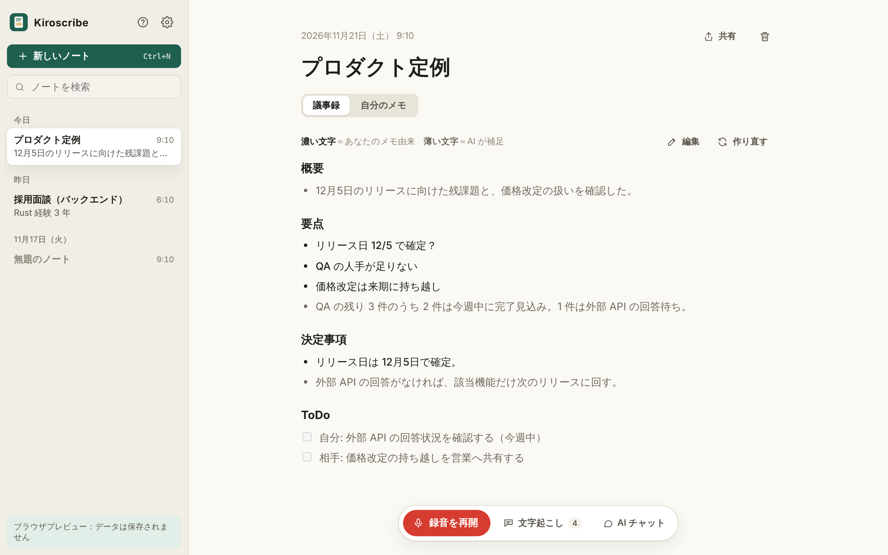
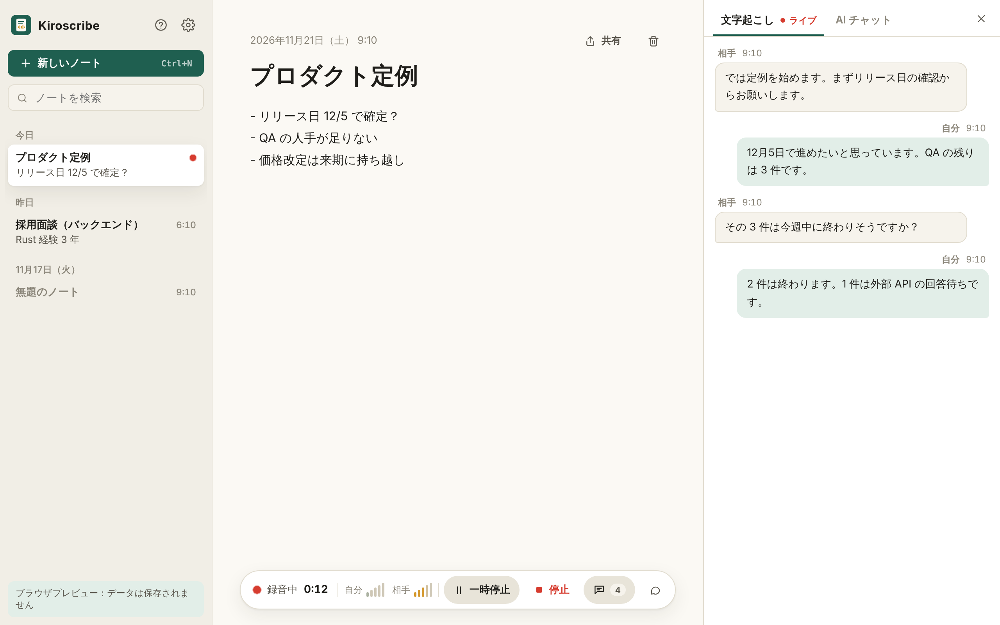
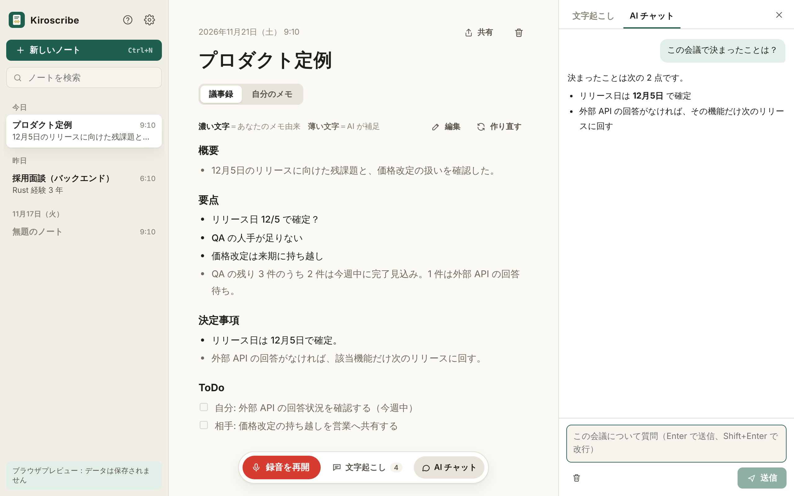
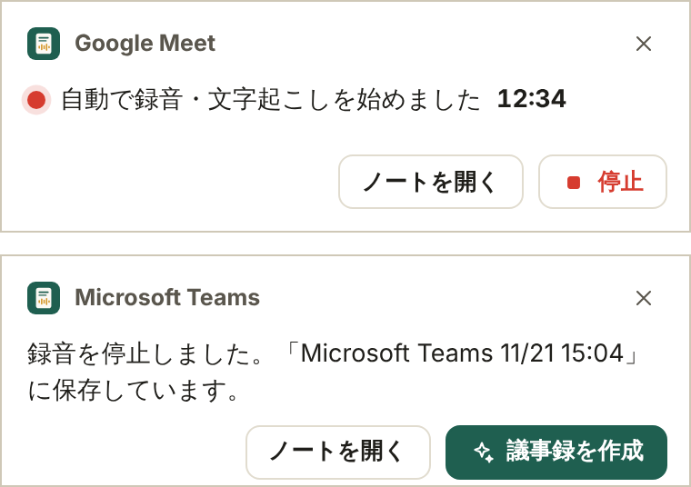
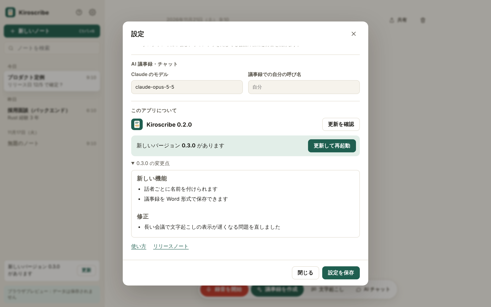
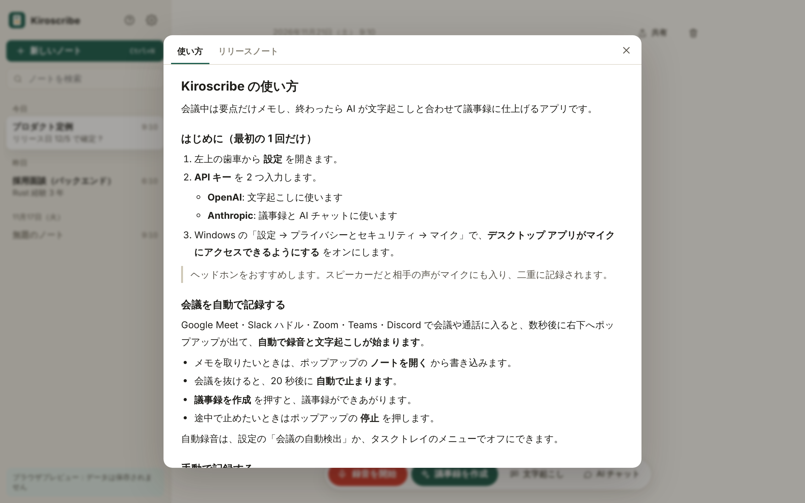

# Kiroscribe（kiroku〈記録〉+ transcribe）— AI 会議メモ

会議中は要点だけを自分でメモし、会議が終わったら AI が文字起こしと合わせて議事録に仕上げる Windows デスクトップアプリです。
会議にボットを参加させず、PC のマイク（自分の声）とスピーカーに流れる音（相手の声）を直接取り込みます。



## できること

| 機能 | 内容 |
| --- | --- |
| 会議の自動検出 | Google Meet・Slack ハドル・Zoom・Teams・Discord の会議や通話が始まると、自動でノートを作って録音・文字起こしを始め、会議が終わると自動で止めます |
| 録音とライブ文字起こし | マイクを「自分」、PC から流れる音声（Teams・Zoom・Meet など）を「相手」として録音し、数秒遅れで会話形式に表示します |
| AI 議事録 | 自分のメモと文字起こしから、概要・論点・決定事項・ToDo・未決事項をまとめます。自分のメモ由来の行は濃く、AI が補った行は薄く表示します |
| AI チャット | 「決まったことは？」「フォローアップのメール文案を作って」など、ノートの内容について質問できます |
| 共有 | 議事録・メモ・文字起こしを Markdown でコピー、またはファイルに保存できます |
| ノート管理 | 日付ごとの一覧、検索、自動保存 |
| アプリ内更新 | 新しいバージョンが出ると知らせが出て、ボタン 1 つで更新できます。更新は署名を確かめてから適用します |
| ヘルプ | 使い方とリリースノートをアプリの中で確認できます。設定画面にはバージョンを表示します |

| 録音中 | AI チャット |
| --- | --- |
|  |  |

## インストール

1. GitHub の [**Releases**（最新のリリース）](https://github.com/s-tabana/kiroscribe/releases/latest)を開きます。
2. **Assets** から `Kiroscribe_<バージョン>_x64-setup.exe` をダウンロードします（ほかのファイルは、アプリ内更新と下記の確認に使うものです）。
3. ダウンロードした `.exe` を実行します。インストールはユーザー単位なので管理者権限は要りません。
4. コード署名をしていないため、SmartScreen の警告が出たら「詳細情報」→「実行」を選びます。

動作には Microsoft Edge WebView2 ランタイムが必要です（Windows 10 / 11 には通常入っています）。
2 回目からは、アプリの中で更新できます（[更新とヘルプ](#更新とヘルプ)）。

### ダウンロードしたファイルを確かめる

必須ではありませんが、インストーラが配布元のものと同じかを、次の 2 つの方法で確かめられます（0.2.0 以降のリリース）。

- **SHA-256 を照合する**: PowerShell で次を実行し、表示された `Hash` が、同じリリースに添付されている `SHA256SUMS.txt` の値と同じであることを確かめます（大文字・小文字の違いは無視してかまいません）。ダウンロードの途中で壊れたり、すり替えられたりしていないことが分かります。

  ```powershell
  Get-FileHash .\Kiroscribe_0.2.0_x64-setup.exe -Algorithm SHA256
  ```

- **ビルドの来歴を確かめる**: [GitHub CLI](https://cli.github.com/)（`gh`。ログインが必要です）で次を実行します。成功すれば、そのファイルが「このリポジトリのリリース用ワークフローが GitHub Actions 上でビルドしたもの」だと分かります。

  ```powershell
  gh attestation verify .\Kiroscribe_0.2.0_x64-setup.exe --repo s-tabana/kiroscribe
  ```

### 以前の Kiroku を使っていた場合

Kiroscribe は、以前の名前「Kiroku」とは別のアプリとしてインストールされます（Kiroku は上書きされずに残ります）。

- Kiroscribe を最初に起動したときに、Kiroku のノート（文字起こし・議事録・チャット・設定を含む）と API キーが自動で引き継がれます。Kiroku 側のデータは消えません。
- 引き継がれたことを確かめたら、Windows の「設定 → アプリ」から **Kiroku をアンインストール**してください。両方を残すと、両方が会議を検出して二重に録音します。
- 引き継ぎは最初の起動の 1 回だけです。そのあとに Kiroku で書いた内容は Kiroscribe には反映されません。

## 最初の設定

左上の歯車から設定画面を開きます。

1. **API キー**を 2 つ入力します。キーは Windows 資格情報マネージャー（「Kiroscribe」を含む名前の汎用資格情報）に保存され、画面には表示されません。
   - **OpenAI**（文字起こしに使用）: OpenAI のプラットフォームで発行したキー
   - **Anthropic**（議事録と AI チャットに使用）: Claude Console で発行したキー
2. **マイク**を選びます（通常は「既定のマイク」のままで大丈夫です）。
3. 必要なら、文字起こしの**言語**・**モデル**（既定 `gpt-4o-transcribe`）、Claude の**モデル**（既定 `claude-opus-5-5`）、議事録での**自分の呼び名**を変えます。

Windows の「設定 → プライバシーとセキュリティ → マイク」で、**デスクトップ アプリがマイクにアクセスできるようにする**をオンにしてください。

## 使い方

### 会議を自動で記録する（既定）

Kiroscribe は Windows の起動時に立ち上がり、タスクトレイに常駐して会議を待ちます。

1. いつもどおり Google Meet・Slack ハドル・Zoom・Teams で会議に参加します（Discord ならボイスチャンネルか通話に入ります）。
2. 数秒後、画面右下にポップアップが出て、**自動で録音・文字起こしが始まります**。ノートは「Google Meet 11/20 15:04」のような名前で作られます。
3. 会議中にメモを取りたいときは、ポップアップの **ノートを開く** から書き込みます。
4. 会議を抜けると、20 秒後に**自動で録音が止まり**、ポップアップで知らせます。
5. **議事録を作成** を押すと、ノートが開いて議事録が作られます。



- 録音を途中で止めたいときはポップアップの **停止** を押します（ポップアップを × で閉じるだけなら録音は続きます）。
- ウィンドウの × で閉じても終了せず、トレイに残ります。完全に終了するにはトレイアイコンの右クリックから **Kiroscribe を終了**。
- 自動録音を止めたいときは、設定の「会議の自動検出」かトレイのメニューでオフにします。Windows 起動時の自動起動も設定でオフにできます。
- 自分で録音しているあいだに会議を検出しても、そのまま自分の録音を続けます。

#### 検出の仕組み

2 秒ごとに「いまどのアプリがマイクを使っているか」を調べます（Windows がタスクバーのマイク表示のために記録している情報です）。

| 会議 | 判定の方法 |
| --- | --- |
| Slack ハドル・Zoom・Teams・Discord（デスクトップ版） | そのアプリがマイクを使っている |
| ブラウザでの Google Meet・Slack・Teams・Zoom・Discord | ブラウザがマイクを使っていて、表示中のタブのタイトルが会議のもの（例:「Meet - abc-defg-hij」） |

マイクの使用が 4 秒続いたら会議の開始、マイクを使わなくなって 20 秒たったら会議の終了とみなします。
ブラウザの会議は、始まったあとで別のタブに切り替えても、ブラウザがマイクを使っている間は続いているとみなします。

### 手動で記録する

1. **新しいノート**（Ctrl+N）を作り、タイトルを付けます（空のままなら議事録作成時に自動で付きます）。
2. 会議が始まったら **録音を開始**。右側に文字起こしが表示されます。
3. 気になったこと・決まったことを、走り書きでメモします。
4. 会議が終わったら **停止**。最後の発話の文字起こしが終わるまで数秒待ちます。
5. **議事録を作成** を押すと、議事録が少しずつ表示されます。手で直す場合は **編集**、作り直す場合は **作り直す**。
6. **AI チャット** で、会議について質問できます。
7. **共有** から Markdown をコピーして Slack やメールに貼るか、ファイルに保存します。

> **ヘッドホンの利用をおすすめします。** スピーカーで聞くと相手の声がマイクにも入り、「自分」と「相手」の両方に記録されます。

### 更新とヘルプ

- **更新**: 新しいバージョンが出ると、左下と設定画面に知らせが出ます。左下の **更新**、または設定画面の **更新して再起動** を押すと、ダウンロードが終わりしだいアプリが新しいバージョンで起動し直します。
  - 録音中と、AI が議事録や回答を作っている間は更新できません（終わってから押してください）。
  - 更新のファイルは、署名を確かめてから適用します。署名が合わないファイルはインストールしません。
  - 自動で行うのは新しいバージョンの確認までで、インストールは必ずボタンを押したときに始まります。
- **バージョンの確認**: 設定画面のいちばん下「このアプリについて」に、いまのバージョンが表示されます。**更新を確認** で、すぐに調べることもできます。
- **ヘルプ**: 左上の **？** から、**使い方** と **リリースノート**（バージョンごとの変更点）を開けます。インターネットにつながっていないときは、前回取得した内容か、アプリに同梱の内容を表示します。

| 設定画面の「このアプリについて」 | ヘルプ |
| --- | --- |
|  |  |

## データとプライバシー

- **会議の検出**: マイクを使っているアプリの名前と、ウィンドウのタイトルを PC 内で調べるだけで、外部には送りません。
- **録音される相手への配慮**: 自動録音を使う場合も、会議の参加者に記録していることを伝え、必要なら同意を得てください。社内規程で録音が禁止されている会議では、自動検出をオフにするか、ポップアップの **停止** で止めてください。
- **保存場所**: ノート・文字起こし・議事録・チャットはこの PC の `%APPDATA%\dev.kiroscribe.desktop\kiroscribe.db`（SQLite）にだけ保存されます。**音声ファイルは保存しません。**
- **外部への送信**:
  - 録音中、発話の区切りごとの音声を **OpenAI** に送って文字起こしします（無音・雑音だけの区間は送りません）。
  - 議事録の作成と AI チャットのときに、メモ・文字起こし・議事録のテキストを **Anthropic** に送ります。
  - 更新の確認（起動の少しあとと、その後は約 6 時間ごと）と、ヘルプ画面を開いたときの使い方・リリースノートの取得のために、**GitHub**（`github.com`・`raw.githubusercontent.com`・`api.github.com`）に問い合わせます。送るのは通常の HTTP リクエストだけで、ノート・音声・API キーは送りません。更新するときは、インストーラも GitHub からダウンロードします。
- **API キー**: Windows 資格情報マネージャーに保存し、送る先はそれぞれの API（OpenAI・Anthropic）だけです。
- **料金**: 各 API の利用料金は、入力したキーのアカウントに課金されます。
- **脆弱性の報告**: セキュリティ上の問題を見つけたときは、公開の Issue には書かず、[SECURITY.md](SECURITY.md) の方法で非公開のまま知らせてください。

## 既知の制約

- 相手の声（システム音声）の取り込みは Windows のみ対応です。
- 相手が複数人いても、すべて「相手」として記録されます（話者は区別しません）。
- 文字起こしは発話の区切りごとに行うため、数秒遅れて表示されます。
- 同時に録音できるのは 1 つのノートだけです。
- 議事録の色分けは、メモと議事録の文字の重なりから機械的に判定しています。
- 会議の自動検出は Windows のみ対応です。ブラウザの会議は、会議の開始時に会議のタブを表示している必要があります（別のタブを見ながら参加した場合は、そのタブに切り替えた時点で検出します）。
- 検出の対象は Google Meet・Slack ハドル・Zoom・Teams・Discord です。それ以外の会議アプリ（Webex など）は手動で録音してください。
- Discord のボイスチャンネルに入りっぱなしにすると、その間ずっと録音・文字起こしが続き、OpenAI の利用料金がかかります。会議以外で通話するときは、トレイのメニューで自動録音をオフにするか、ポップアップの **停止** で止めてください。
- 検出はマイクの使用で判断するため、会議アプリがマイクを使っていれば、ミュート中も「会議中」とみなします。
- Windows のコード署名はしていないため、初回インストール時に SmartScreen の警告が出ます（アプリ内更新で配るファイルは、これとは別の署名で改ざんがないことを確かめています）。

## 開発

### 構成

```text
kiroscribe/
├── crates/core/         UI に依存しないロジック（保存・音声処理・文字起こし・Claude API・書き出し）
├── src-tauri/           Tauri アプリ（コマンドとイベント）
├── src/                 画面（React + TypeScript）
├── scripts/             リリース用のスクリプトと、そのテスト
├── .github/             CI（ci.yml）・リリース（release.yml）・依存関係の検査（audit.yml）と、Dependabot の設定
├── CHANGELOG.md         変更履歴（リリースノートの原稿）
├── SECURITY.md          脆弱性の報告方法
└── docs/                使い方（アプリのヘルプに表示する guide.md）とスクリーンショット
```

### 必要なもの

- Rust（stable）、Node.js 22 以上
- Windows: Visual Studio Build Tools（C++）と WebView2
- Linux（開発用）: `libwebkit2gtk-4.1-dev`、`libasound2-dev`、`libssl-dev` など（[Tauri の前提条件](https://v2.tauri.app/start/prerequisites/)）

### コマンド

```bash
npm ci                 # 依存関係のインストール
npm run tauri dev      # アプリを開発モードで起動
npm run dev            # ブラウザでのデザイン確認（メモリ上のデモデータ。保存されません）
npm test               # vitest と cargo test

# インストーラの作成（target/release/bundle/nsis/）。
# 手元には更新用の署名鍵がないので、署名の要る成果物を作らない設定を重ねる
npm run tauri build -- --config scripts/tauri.ci.conf.json

# リリース用スクリプトのテスト
(cd scripts && node --test)

# 録音デバイスの動作確認（API は呼びません）
cargo run -p kiroscribe-core --example record_probe -- 15
```

`--config` を付けずに `npm run tauri build` を実行すると、インストーラを作ったあとの署名で「`TAURI_SIGNING_PRIVATE_KEY` がない」というエラーになります（`tauri.conf.json` の `bundle.createUpdaterArtifacts` が有効なため）。PowerShell では `--` 以降の引数が npm に渡らないことがあるので、そのときは Git Bash から実行してください。

### CI

`.github/workflows/ci.yml` が、main への push と pull request のたびに Windows で次を行います。

1. バージョンの確認（`package.json`・`Cargo.toml`・`tauri.conf.json` がそろっているか）と、リリース用スクリプトのテスト
2. 型チェック、フロントエンドのテスト（vitest）、Rust のテスト（cargo test）
3. インストーラのビルド。できた `Kiroscribe_<バージョン>_x64-setup.exe` を成果物（Artifacts）として 14 日間保存します

CI では署名鍵を使いません。CI のインストーラは動作確認用で、利用者に配るのはリリースで作ったものです。

### 依存関係の検査

`.github/workflows/audit.yml` が、週に 1 回（月曜の朝）と、`Cargo.lock`・`package-lock.json` が変わったときに、依存しているライブラリに公表済みの脆弱性がないかを調べます（`cargo audit` と `npm audit --audit-level=high`）。脆弱性が見つかると失敗します。「メンテナンスされていない」などの警告は、実行結果の Summary に表示するだけで失敗にはしません。手元でも同じ検査ができます。

```bash
cargo install cargo-audit --locked   # 最初の 1 回だけ
cargo audit
npm audit --audit-level=high
```

依存関係とアクションの更新は、Dependabot（`.github/dependabot.yml`）が週に 1 回プルリクエストにします。ワークフローで使うアクションは、タグではなくコミットのハッシュで固定しています（行末のコメントがバージョン）。

### リリースの手順

`v0.3.0` のようなタグを push すると、`.github/workflows/release.yml` が署名付きのインストーラをビルドして GitHub Release を作ります。利用者のアプリは、Release に添付された `latest.json` を見て更新に気づきます。

1. **バージョンを上げる。** `package.json` の `version` と、`Cargo.toml` の `[workspace.package]` の `version` を同じ値にします（`tauri.conf.json` は `package.json` を参照しています）。lock ファイルも合わせます。

   ```bash
   npm install --package-lock-only   # package-lock.json
   cargo update --workspace          # Cargo.lock
   node scripts/check-version.mjs    # そろっていればバージョンが表示される
   ```

2. **`CHANGELOG.md` に節を書く。** 見出しは `## 0.3.0 (2026-12-01)` の形です。この節の本文が、そのまま GitHub のリリース本文とアプリ内のリリースノートになります。次のコマンドで、取り出される内容を確かめられます。

   ```bash
   node scripts/release-notes.mjs --version 0.3.0
   ```

3. **main にマージする。** CI が通ったことを確かめます。

4. **タグを付けて push する。** タグは `v` + バージョンです。

   ```bash
   git switch main && git pull
   git tag v0.3.0
   git push origin v0.3.0
   ```

   タグを push する代わりに、GitHub の **Actions → release → Run workflow** で main ブランチを選び、バージョン（例: `0.3.0`）を入力して実行することもできます。この場合、タグ `v0.3.0` は公開のときに自動で付きます。

5. **Actions の release を見届ける。** 承認制にしている場合は、Actions の画面で **Review deployments** から承認すると始まります（下の「リリースを承認制にする」）。成功すると、Release に次の 4 つが添付されます。利用者のアプリは、次に更新を確認したときに知らせを出します。

   | ファイル | 役割 |
   | --- | --- |
   | `Kiroscribe_<バージョン>_x64-setup.exe` | インストーラ（新規のインストールにも、アプリ内更新にも使う） |
   | `Kiroscribe_<バージョン>_x64-setup.exe.sig` | 更新用の署名 |
   | `latest.json` | アプリが更新の有無を調べるためのファイル（バージョン・リリースノート・インストーラの URL・署名） |
   | `SHA256SUMS.txt` | インストーラの SHA-256（利用者がダウンロードしたファイルを照合するためのもの） |

   あわせて、インストーラに「ビルドの来歴の証明（attestation）」を付けます。`gh attestation verify <ファイル> --repo s-tabana/kiroscribe` で確かめられます（[ダウンロードしたファイルを確かめる](#ダウンロードしたファイルを確かめる)）。

release.yml は、次の場合に Release を作らずに失敗します。

- タグとバージョンが合わない、または `package.json`・`Cargo.toml`・`tauri.conf.json` のバージョンが食い違っている
- `CHANGELOG.md` にそのバージョンの節がない
- 署名鍵の Secret が未設定、または秘密鍵がアプリに埋め込んだ公開鍵と対になっていない
- テストかビルドが失敗した
- ビルドの来歴の証明（attestation）を付けられなかった

やり直すとき:

- **ワークフローの一時的な失敗**なら、Actions の画面から再実行します。同じタグの Release が既にあれば、添付ファイルと本文を上書きします。
- **公開前に直すことが見つかった**ら、修正を main に入れてからタグを付け直します（`git tag -d v0.3.0 && git push origin :refs/tags/v0.3.0` のあと、手順 4 をやり直す）。
- **公開後に不具合が見つかった**ら、同じバージョンを差し替えずに、次のバージョンを出します（すでに更新した利用者には、同じバージョンの差し替えは届きません）。

`0.3.0-beta.1` のようにハイフンの付くバージョンは、GitHub の「プレリリース」として公開します。プレリリースは最新のリリースとして扱われないので、利用者のアプリには配られません。

#### リリースを承認制にする

release.yml のジョブは、Environment「`release`」で動きます（Environment は最初の実行で自動的に作られ、そのままでは何も制限しません）。

- **Settings → Environments → release** の **Required reviewers** に自分を入れると、タグを push しても、Actions の画面で承認するまでビルドも公開も始まりません（間違えて push したタグや、意図しないタグからのリリースを止められます）。
- 同じ画面の **Deployment branches and tags** で、`v*` のタグだけを許可できます（Actions の画面から手動で実行する方法も使う場合は、main ブランチも許可してください）。
- 署名鍵の Secret を、リポジトリではなくこの Environment に登録し直すと、この Environment を指定して上の条件（承認・タグの制限）を通ったジョブだけが鍵を読めるようになります（リポジトリの Secret のままでも動きます）。

### 更新用の署名鍵

アプリ内更新のファイルは、Tauri の updater の鍵で署名しています（Windows のコード署名とは別物で、SmartScreen の警告はなくなりません）。インストール済みのアプリは、自分に埋め込まれた公開鍵で検証できた更新だけを受け付けます。

| もの | 置き場所 |
| --- | --- |
| 公開鍵 | `src-tauri/tauri.conf.json` の `plugins.updater.pubkey` |
| 秘密鍵 | リポジトリの Secret **`TAURI_SIGNING_PRIVATE_KEY`**（Settings → Secrets and variables → Actions）。Environment「`release`」の Secret にしてもかまいません |
| 秘密鍵のパスワード | 今の鍵にはありません。パスワード付きの鍵に替えたときだけ、Secret `TAURI_SIGNING_PRIVATE_KEY_PASSWORD` に登録します |

- **秘密鍵は、Secret とは別の安全な場所（パスワードマネージャなど）にも保管してください。** GitHub の Secret は、登録したあとで中身を読み出せません。秘密鍵をなくすと、これまでの利用者にアプリ内更新を届けられなくなります（新しい鍵で作ったインストーラを、手動で入れ直してもらうしかありません）。
- 秘密鍵は、リポジトリにコミットしないでください。漏れた場合は鍵を作り直し、公開鍵を入れ替えたバージョンを古い鍵で署名して配ってから、新しい鍵に切り替えます。
- 鍵を作り直すときは `npm run tauri signer generate -- -w <保存先のファイル>` を使います。

## ライセンス

Copyright (C) 2026 s-tabana

Kiroscribe は自由ソフトウェアです。GNU General Public License バージョン 3（GPL-3.0）の条件のもとで、利用・改変・再配布ができます。改変したものを配布するときは、同じ GPL-3.0 でソースコードを公開する必要があります。

このソフトウェアは有用であることを願って配布されていますが、**いかなる保証もありません**。ライセンスの全文は [LICENSE](LICENSE) にあります。
